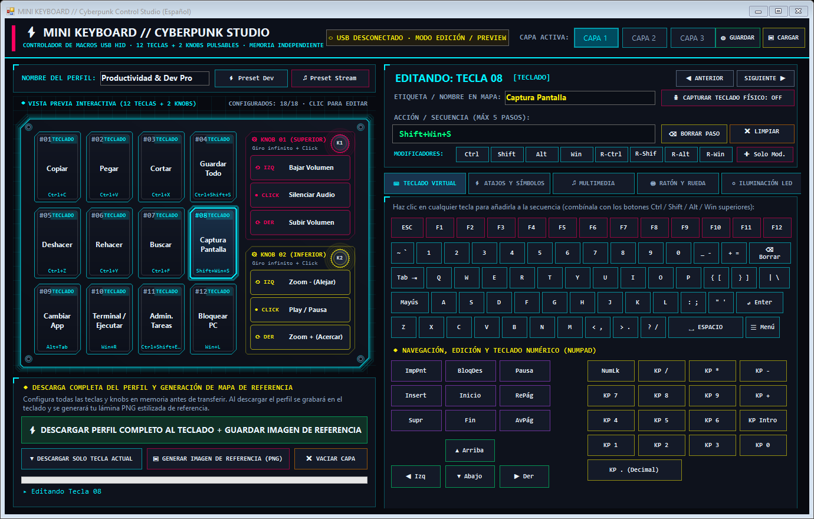
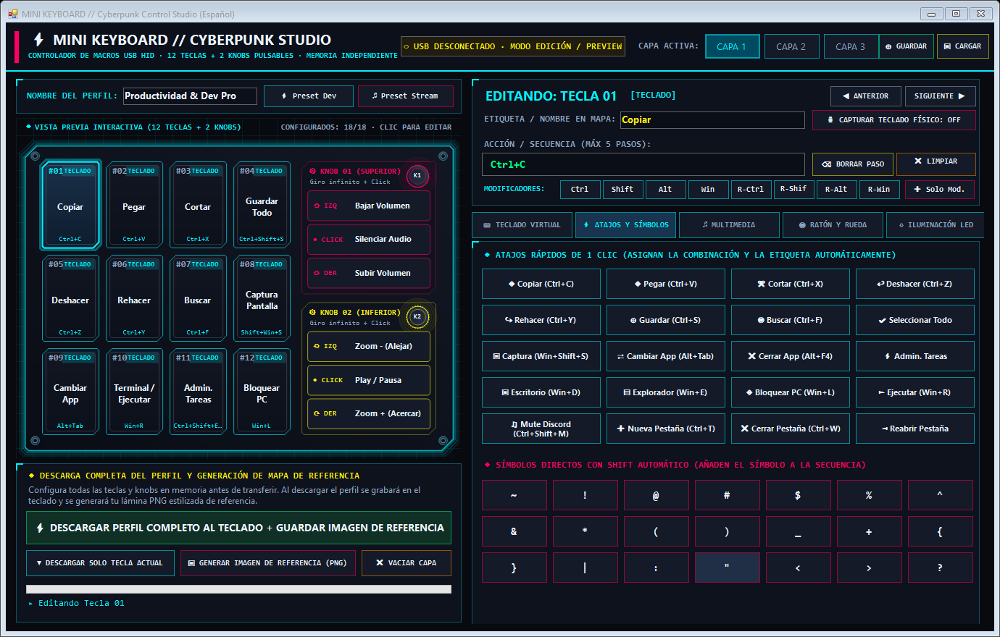
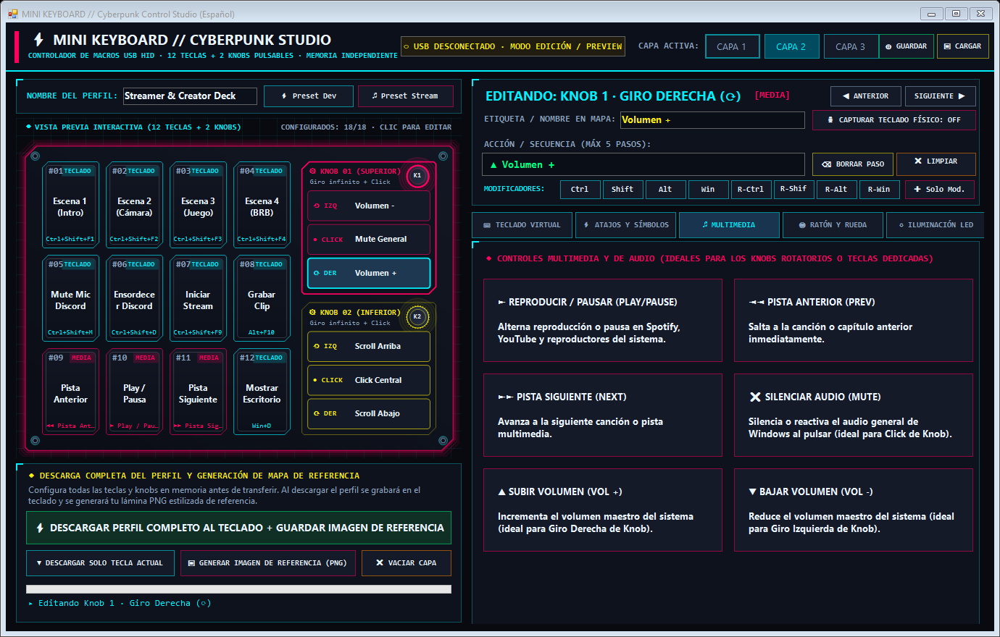
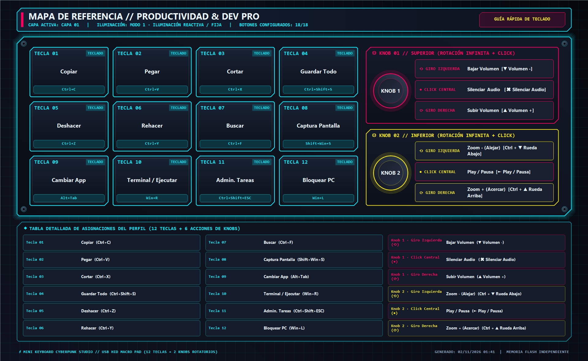
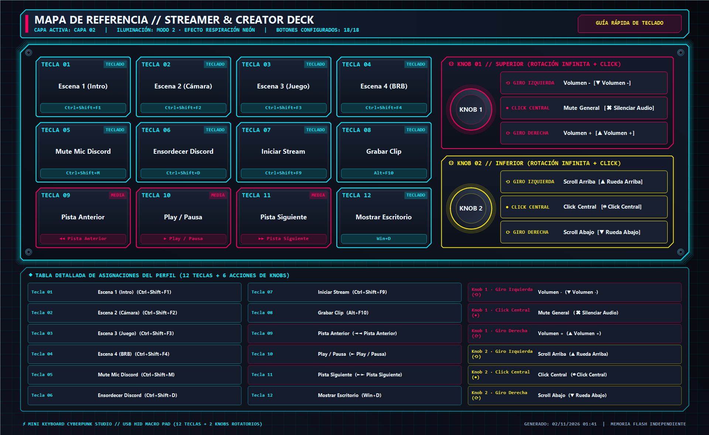

# ⚡ MINI KeyBoard — Cyberpunk Control Studio (Edición en Español)



Software de control y programación **portable** en español con interfaz **Cyberpunk HUD** para el miniteclado macro programable USB HID de **12 teclas mecánicas y 2 perillas rotatorias (knobs) con pulsación central**.

El programa permite diseñar perfiles completos en memoria y grabarlos directamente en la **memoria Flash interna** del miniteclado (`VID: 0x1189` / `PID: 0x8890`). Una vez descargada la configuración, el miniteclado funciona de manera **100 % independiente** en cualquier PC, Mac, Linux o consola sin necesidad de mantener el software abierto.

---

## 🚀 Nuevas Funcionalidades y Mejoras Principales

1. **Interfaz 100 % en Español con Estética Cyberpunk Moderna**:
   - Diseño oscuro *Cyber-Noir* (`#080A10`) con acentos en neón cian (`#00F0FF`), magenta (`#FF005F`), amarillo cyber (`#FCEE0A`) y verde matriz (`#00FF80`).
   - Indicador en tiempo real del estado de conexión USB HID y versión de protocolo detectada.

2. **Vista Previa Interactiva y Estilizada de la Botonera (12 Teclas + 2 Knobs)**:
   - Representación visual interactiva del chasis acrílico con sus **12 teclas mecánicas** (distribuidas en matriz de 3 filas × 4 columnas) y los **2 codificadores rotatorios infinitos pulsables** a la derecha (`Knob 1 Superior` y `Knob 2 Inferior`).
   - Cada tecla (`#01` a `#12`) y cada acción de los knobs (`⟲ Giro Izquierda`, `● Click Central`, `⟳ Giro Derecha`) muestra en vivo su etiqueta personalizada, el tipo de función (`TECLADO`, `MACRO`, `MEDIA`, `RATÓN`) y la combinación asignada.
   - Selección directa haciendo clic sobre cualquier tecla o zona de giro en la vista previa.

3. **Configuración Completa del Perfil Antes de Descargar**:
   - A diferencia del software original (donde cambiar de tecla descartaba la edición si no se descargaba tecla por tecla), esta versión mantiene **las 18 asignaciones de cada una de las 3 capas en memoria**.
   - Permite configurar tranquilamente las 12 teclas, las 6 acciones de los 2 knobs y el modo de iluminación LED, revisar el mapa completo en pantalla y **descargar todo el perfil de una sola vez** con el botón **`⚡ DESCARGAR PERFIL COMPLETO AL TECLADO`**.
   - También conserva el botón **`▼ DESCARGAR SOLO TECLA ACTUAL`** para actualizaciones rápidas individuales y soporte para **Guardar / Cargar perfiles (`.mkp` / `.xml`)** en disco, además de plantillas preconfiguradas (*Preset Dev/Productividad* y *Preset Streamer*).

4. **Generación Automática de Lámina de Referencia Estilizada (`.PNG`) al Descargar**:
   - Al descargar una configuración al miniteclado (o en cualquier momento mediante el botón **`▣ GENERAR IMAGEN DE REFERENCIA (PNG)`**), el programa abre un cuadro de diálogo preguntando **dónde deseas guardar la imagen de referencia**.
   - Genera una infografía **Cyberpunk de alta resolución (`1920 × 1180 px`)** con el esquema visual del miniteclado, las etiquetas descriptivas de cada tecla y knob, las combinaciones técnicas exactas y una tabla detallada de las 18 funciones para conservarla como guía rápida en el escritorio o imprimirla.

5. **Grabación desde Teclado Físico + Atajos Rápidos de 1 Clic**:
   - Modo **`🎙️ CAPTURAR TECLADO FÍSICO`** para presionar directamente la combinación deseada en tu teclado normal.
   - Pestaña de **Atajos Rápidos de 1 Clic** (Copiar, Pegar, Cortar, Deshacer, Captura de Pantalla, Cambiar Ventana, Mute Discord, Administrador de Tareas, etc.) que asigna tanto el comando HID como el nombre descriptivo automáticamente.

---

## 📸 Capturas de Pantalla del Software

### 1. Vista Principal y Teclado Virtual Completo


### 2. Pestaña de Atajos Rápidos de 1 Clic y Símbolos con Shift


### 3. Configuración Multimedia y Knobs Rotatorios (Perfil Streamer)


---

## 🖼️ Ejemplo de Láminas de Referencia Generadas al Descargar

Cuando descargas tu perfil al teclado, el software genera automáticamente un mapa visual estilizado como los siguientes:

### Mapa Generado — Perfil Productividad & Dev Pro (Capa 1)


### Mapa Generado — Perfil Streamer & Creator Deck (Capa 2)


---

## 🎛️ Disposición Física del Hardware (12 Teclas + 2 Knobs)

El miniteclado cuenta con **12 interruptores mecánicos** (`Tecla 1` a `Tecla 12`) y **2 perillas rotatorias con pulsador integrado** (`Knob 1` y `Knob 2`), sumando **18 acciones programables por capa** (hasta 54 acciones en las 3 capas conmutables):

| Referencia Física del Teclado | Mapeo de Slots en Hardware HID |
| :---: | :--- |
|  | **Fila Superior:** Teclas `01`, `02`, `03`, `04` (`Slot ID 1..4`)<br>**Fila Media:** Teclas `05`, `06`, `07`, `08` (`Slot ID 5..8`)<br>**Fila Inferior:** Teclas `09`, `10`, `11`, `12` (`Slot ID 9..12`)<br><br>**Knob 1 (Superior):**<br>• `⟲ Giro Izquierda` (`Slot ID 13`)<br>• `● Click Central` (`Slot ID 14`)<br>• `⟳ Giro Derecha` (`Slot ID 15`)<br><br>**Knob 2 (Inferior):**<br>• `⟲ Giro Izquierda` (`Slot ID 16`)<br>• `● Click Central` (`Slot ID 17`)<br>• `⟳ Giro Derecha` (`Slot ID 18`) |

---

## 🛠️ Resumen del Stack Tecnológico y Arquitectura

| Componente | Tecnología / Especificación |
| :--- | :--- |
| **Lenguaje y Plataforma** | **C# (.NET Framework 4.0 · x86 Portable)** — Ejecución nativa inmediata en Windows sin requerir instaladores ni runtimes externos adicionales. |
| **Motor Gráfico UI e Infografías** | **Windows Forms Custom GDI+ (`System.Drawing` & `Drawing2D`)** con doble búfer (`OptimizedDoubleBuffer`), antialiasing vectorial (`SmoothingMode.AntiAlias`), tipografía `ClearTypeGridFit` y generador de láminas PNG de `1920×1180 px` en 32 bits ARGB. |
| **Comunicación Hardware USB** | **USB HID (`HidLibrary.dll`)** comunicándose con el controlador `VID = 0x1189`, `PID = 0x8890`, interfaz `mi_01` mediante paquetes de reporte de 8/65 bytes. |
| **Protocolo de Grabación Flash** | Detección automática de versión de firmware (`ReportID` `3`, `0` o `2`), selección de capa (`0xA1`), secuencias de hasta 5 pasos con máscaras de modificadores (`Ctrl`, `Shift`, `Alt`, `Win`), códigos multimedia/ratón, control LED (`0xB0`) y comando de persistencia en EEPROM/Flash (`0xAA 0xAA` / `0xAA 0xA1`). |
| **Persistencia de Perfiles** | Serialización estructurada en XML (`System.Xml.Serialization`) mediante archivos `.mkp` / `.xml`. |

---

## 📂 Estructura del Proyecto

```text
minikeyboard/
├── MINI KeyBoard.exe               # Ejecutable portable listo para usar
├── MINI KeyBoard.exe.config        # Configuración de runtime .NET
├── HidLibrary.dll                  # Librería de comunicación USB HID
├── src/                            # Código fuente modular en C#
│   ├── Program.cs                  # Punto de entrada y CLI de generación documental
│   ├── MainForm.cs                 # Interfaz principal Cyberpunk en español
│   ├── KeypadPreviewControl.cs     # Control interactivo de vista previa (12 teclas + 2 knobs)
│   ├── ReferenceImageGenerator.cs  # Motor GDI+ generador del mapa de referencia PNG
│   ├── HidDeviceController.cs      # Controlador e implementación del protocolo USB HID
│   ├── Models.cs                   # Modelos de perfiles, teclas, macros y mapeo HID
│   └── CyberTheme.cs               # Paleta de colores neón y geometría vectorial HUD
├── docs/capturas/                  # Capturas de pantalla de la interfaz y mapas generados
└── imagenes referencia/            # Imágenes de referencia del hardware original
```

---

## 📖 Guía Rápida de Uso

1. **Ejecutar el programa**: Abre directamente **`MINI KeyBoard.exe`** (no requiere instalación; solo debe estar acompañado de `HidLibrary.dll` en la misma carpeta).
2. **Seleccionar Capa (`CAPA 1`, `CAPA 2` o `CAPA 3`)**: Elige en la barra superior cuál de las 3 capas del teclado deseas configurar.
3. **Configurar todas las teclas y knobs**:
   - Haz clic sobre cualquier tecla (`#01` a `#12`) o acción de knob (`⟲ IZQ`, `● CLICK`, `⟳ DER`) en la **Vista Previa Interactiva** de la izquierda.
   - Escribe opcionalmente un nombre corto en **Etiqueta / Nombre en Mapa** (por ejemplo: `Copiar`, `Mute Discord`, `Zoom +`).
   - Asigna su acción usando las 5 pestañas de la derecha (`Teclado Virtual`, `Atajos y Símbolos`, `Multimedia`, `Ratón y Rueda` o `Iluminación LED`) o activando **`🎙️ CAPTURAR TECLADO FÍSICO`**.
4. **Descargar el perfil y guardar tu imagen de referencia**:
   - Pulsa el botón verde **`⚡ DESCARGAR PERFIL COMPLETO AL TECLADO + GUARDAR IMAGEN DE REFERENCIA`**.
   - El software transferirá todas las asignaciones a la memoria interna del miniteclado y abrirá una ventana para que elijas dónde guardar tu **lámina PNG estilizada de referencia**.

---

## 🔧 Compilación desde el Código Fuente

Para recompilar el ejecutable portable en cualquier equipo con Windows (usando el compilador incluido en `.NET Framework v4.0.30319`):

```powershell
& "C:\Windows\Microsoft.NET\Framework\v4.0.30319\csc.exe" /target:winexe /platform:x86 /optimize+ /out:"MINI KeyBoard.exe" /r:"HidLibrary.dll" /r:System.dll /r:System.Core.dll /r:System.Drawing.dll /r:System.Windows.Forms.dll /r:System.Xml.dll src\Models.cs src\CyberTheme.cs src\HidDeviceController.cs src\KeypadPreviewControl.cs src\ReferenceImageGenerator.cs src\MainForm.cs src\Program.cs
```
